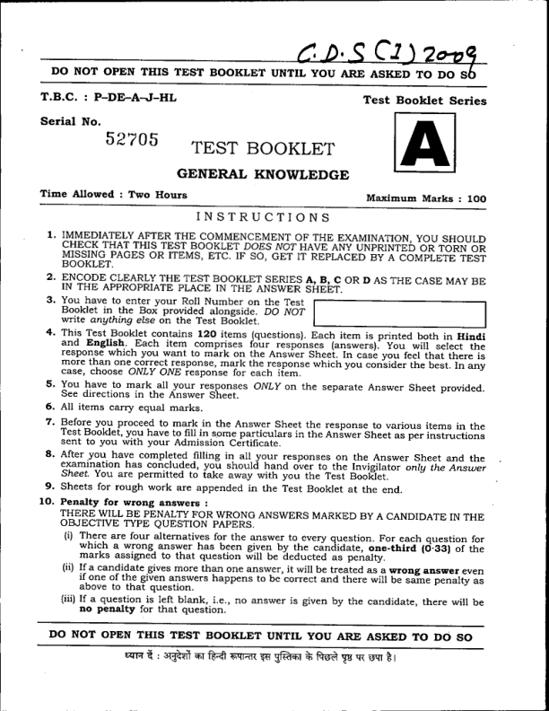

# ⚔️ UPSC CDS Real Test Portal & CBT Simulator

An authentic, offline-first Computer-Based Test (CBT) examination simulator and printable test paper repository for the **Union Public Service Commission (UPSC) Combined Defence Services (CDS)** examination (IMA | INA | AFA | OTA).



---

## 🚀 Key Highlights

- **Complete Year-Wise Official PYQ Archive (2009–2026):**
  - **Whole Question Papers Uploaded:** Every single exam paper has the **complete, full set of questions** (Exactly **120 Questions** for English, **120 Questions** for GS, and **100 Questions** for Mathematics).
  - **Math PYQ:** 35 official year-wise examination papers covering every exam from 2009 to 2026 (100 Qs each = 3,500 questions) in CBT quiz format + official downloadable PDF booklets.
  - **GS PYQ:** 35 official year-wise examination papers covering 2009 to 2026 (120 Qs each = 4,200 questions) with constitutional, scientific, and defence explanations + official PDF booklets.
  - **English PYQ:** 35 official year-wise examination papers covering 2009 to 2026 (120 Qs each = 4,200 questions) across all syllabus topics + official PDF booklets.
  - **Total:** 105 full examination papers with **11,900 questions** in CBT quiz simulator format and 105 authentic question booklets in PDF.
  - Instant toggle between **Math, GS, and English PYQs** with year filter pills (2009 through 2026).
- **Authentic UPSC CBT Simulator:**
  - Real-time countdown timer with pause/resume and low-time alert.
  - Authentic 5-state question palette: Answered (Green), Not Answered (Red), Not Visited (Gray), Marked for Review (Purple), and Answered & Marked for Review (Purple + Green).
  - Save & Next, Clear Response, Mark for Review & Next, and Question Overview modals.
- **Accurate Scoring Standard:**
  - Official UPSC negative marking formulas (+0.833 / -0.277 for English & GS, +1.000 / -0.333 for Mathematics).
  - Mandatory **20.00 Marks (20%)** sectional qualifying threshold check.
  - Merit classification analytics (*Top 1% Exceptional for IMA/AFA, Strong Competitive, Average, Disqualified*).
  - Filterable solution rationales (*All, Correct, Incorrect, Unattempted*).
- **Comprehensive Question Archive & Test Booklets:**
  - Full-length Mock Tests for Paper I (English), Paper II (GS), and Paper III (Mathematics).
  - Dedicated Chapter-wise Test Series across 14 English chapters, 6 GS subjects, and 13 Mathematics chapters.
  - Printable UPSC-styled question paper booklets, companion answer keys, and machine-gradable OMR sheets.

---

## ⚡ Quick Start (Local Run)

Start the local server with one command:

```bash
# Using Python
python server.py

# Or using Node / NPM
npm start
```

Then visit:
```
http://localhost:8080/index.html
```

---

## 🌐 Cloud Deployment Options

This portal is static-ready and can be deployed with zero configuration:

- **Vercel**: Pre-configured via `vercel.json` (push and deploy).
- **Netlify**: Pre-configured via `netlify.toml` with PDF inline viewing headers.
- **GitHub Pages**: Automated workflow ready in `.github/workflows/deploy.yml`.
- **Docker**: Production-ready Nginx Alpine container available via `Dockerfile`.

See [**DEPLOYMENT_GUIDE.md**](./DEPLOYMENT_GUIDE.md) for full step-by-step instructions.

---

## 📚 Bundled Test Papers & OMR Sheet

| File Name | Subject / Description | Items | Marks |
|---|---|---|---|
| `UPSC_CDS_Paper_I_English_Real_Test_Paper.pdf` | General English Full Mock Booklet | 120 Qs | 100 |
| `UPSC_CDS_Paper_II_General_Knowledge_Real_Test_Paper.pdf` | General Knowledge Real Mock Booklet | 239 Qs | 100 |
| `UPSC_CDS_Paper_III_Elementary_Mathematics_Real_Test_Paper.pdf` | Elementary Mathematics Full Mock Booklet | 100 Qs | 100 |
| `UPSC_CDS_English_All_Questions_Paper.pdf` | English Complete PYQ Archive | 981 Qs | — |
| `UPSC_CDS_Math_All_Questions_Paper.pdf` | Mathematics Complete PYQ Archive | 707 Qs | — |
| `UPSC_CDS_GS_All_Questions_Paper.pdf` | General Studies All-Questions Paper | 239 Qs | — |
| `UPSC_CDS_GS_All_Questions_Answer_Key.pdf` | General Studies Official Answer Keys & Explanations | 239 Qs | — |
| `UPSC_CDS_Official_OMR_Sheet.pdf` | Authentic UPSC CDS 120-bubble OMR Answer Sheet | 120 Items | — |
| `UPSC_CDS_Official_Answer_Keys_and_Solutions.pdf` | Comprehensive Master Scoring Keys & Solutions | Papers I-III | — |

---

## 🛠️ Tech Stack

- **Frontend:** Vanilla HTML5, CSS3 (Custom Design System, Glassmorphism, Dark/Light Themes), Modern JavaScript (ES6+).
- **Data Engine:** Pre-compiled high-performance JSON bundles & `test_data.js`.
- **PDF Generation:** Python & ReportLab with official UPSC examination formatting.
- **Hosting / CI/CD:** GitHub Pages / Vercel / Netlify / Docker.

---

## 📄 License
MIT License.
